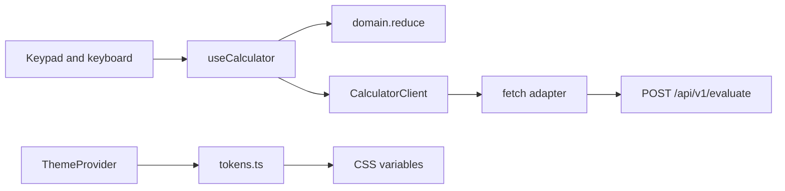

# Architecture

The UI uses the same hexagonal idea as the API. React is an adapter. The rules for keypresses live in a pure function that can be tested without a browser.

## Boundaries

| Layer | May import | Must not import |
| --- | --- | --- |
| `src/domain` | nothing from the app | React, `fetch` |
| `src/application` | domain types if needed | React, `fetch` |
| `src/infrastructure` | the port | components |
| `src/presentation` | the port and the domain | a concrete URL scattered through components |

`App` builds the HTTP client and passes it in. Tests pass a fake client. That is the inbound wiring: the component does not know whether the result came from the network.

## What the domain owns

`reduce` stores tokens and the number currently being typed. `expressionToEvaluate` turns that state into the string the API expects, or `null` when the input is incomplete. `mainDisplay` and `expressionLine` are pure projections.

The hook is the only place that calls `evaluate`. Square root sends `sqrt(n)`. Equals sends the full expression. A failure becomes an error action with the API message.

## Adding a feature

- A new key that only edits text: an action on `reduce`, plus a domain test.
- A new key that needs a result: a small branch in the hook that calls the existing port, plus a component test with a fake client.
- A new endpoint: a method on `CalculatorClient` and the HTTP adapter. Components keep depending on the interface.
